# Notas de Matemática 

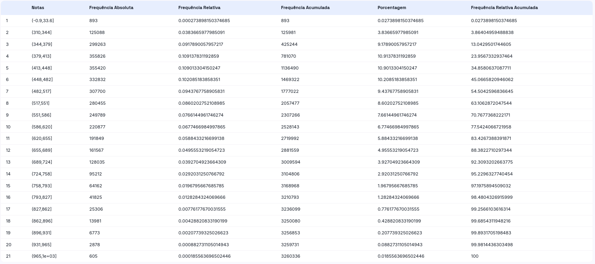

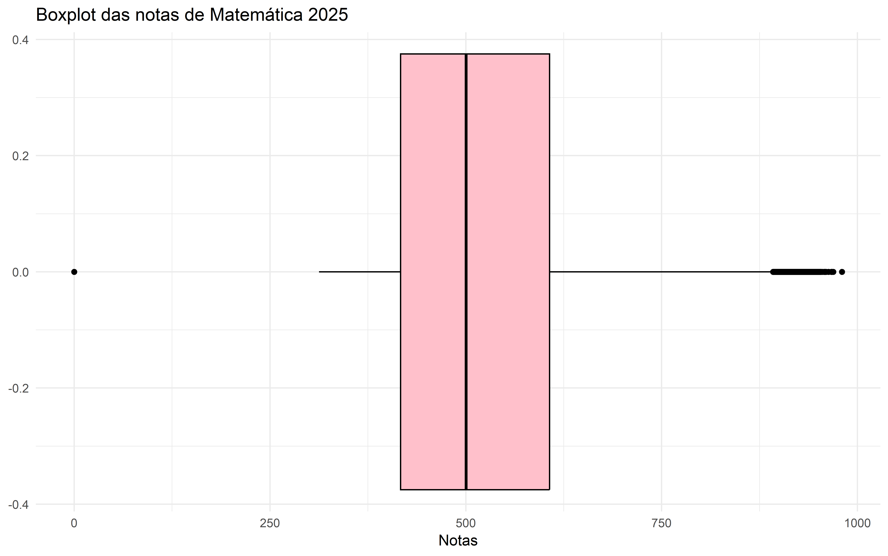

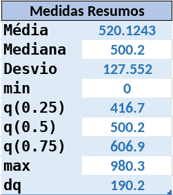

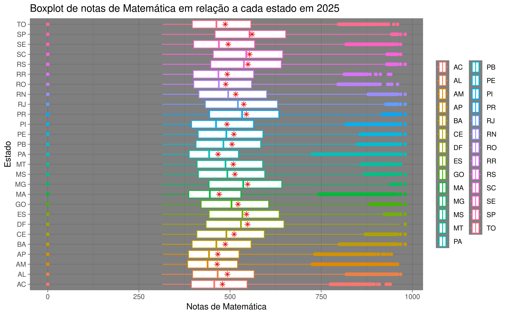

# Notas de Redação

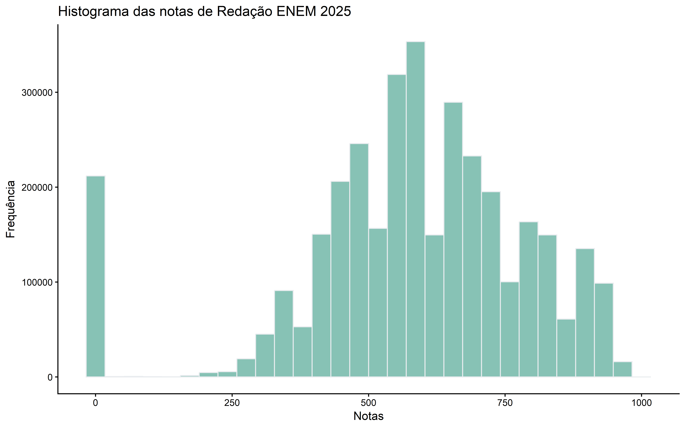

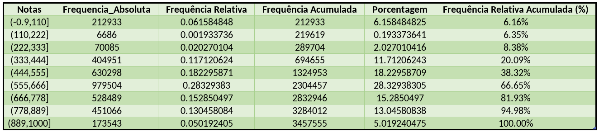

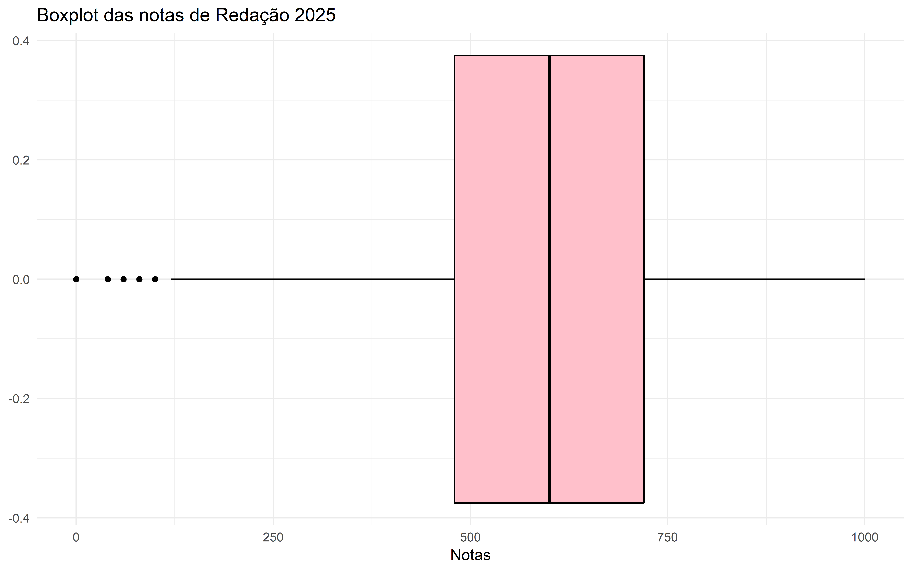

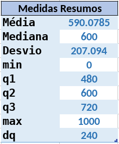

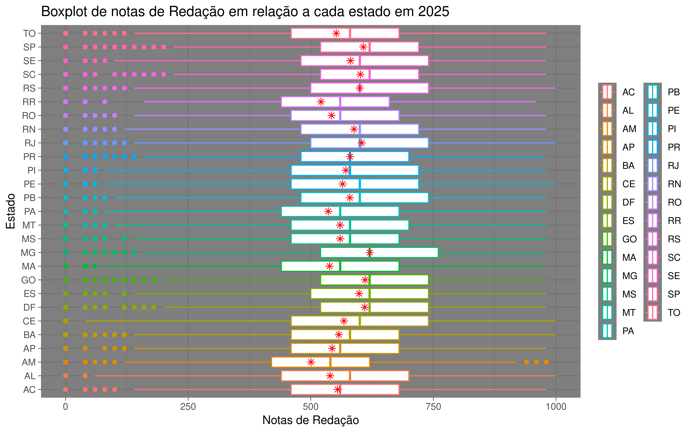
# Análise bivariada

Comparando as duas medidas resumos, podemos observar que os dados das notas de matemática são mais homogêneo que as notas de redação.

 

Realizando o gráfico de dispersão das duas váriaveis, podemos observar visualmente que não há um padrão. Também podemos observar que a correlação de Pearson é fraca.
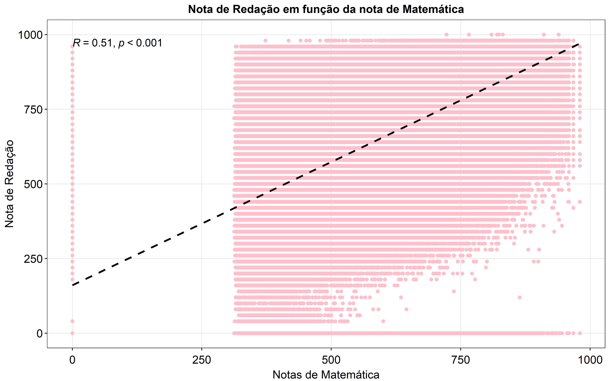

Para responder nossa pergunta, iremos filtar os dados em relação a nota de matemática, baseado em 750, um valor arbitrário que escolhemos.

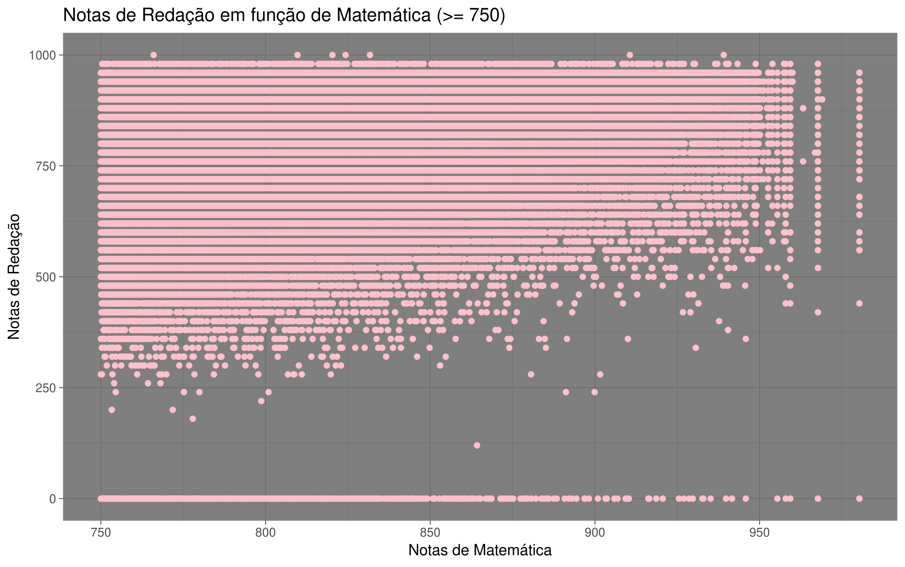

Ao olhar o gráfico ainda não há nenhum padrão, mas vemos que há pessoas que foram muito bem em Matemática, porém zeraram Redação. Vamos construir uma tabela para conseguir análisar esses dados.

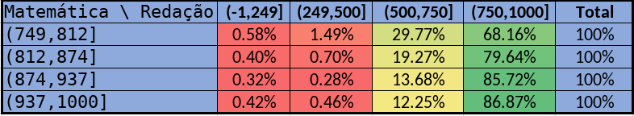

Olhando cada intervalo, podemos concluir que a maioria que foram bem em matemática de certa forma foram bem em redação.

# Conclusão
Logo sim, quem foi bem em matemática em 2025, foi bem em redação.